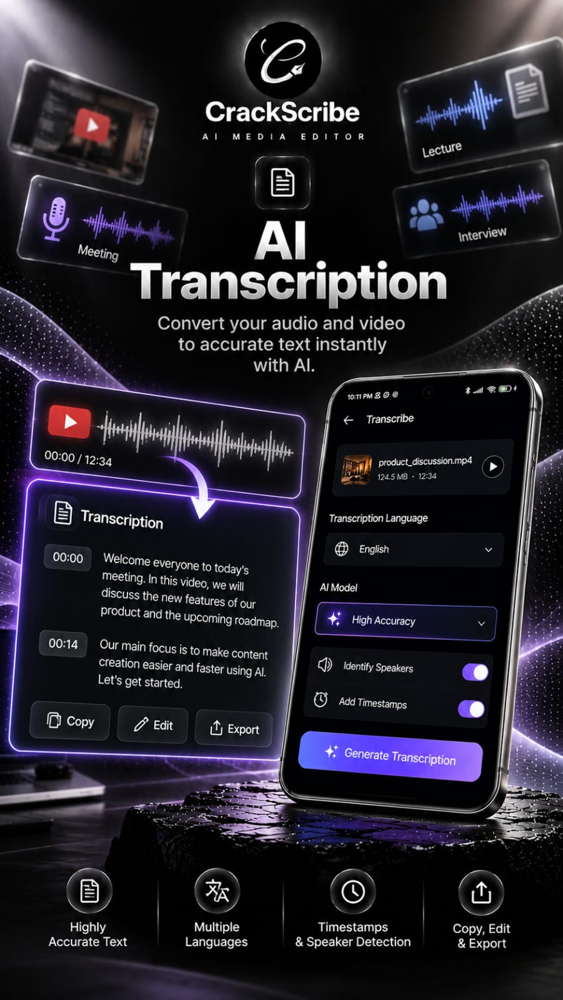
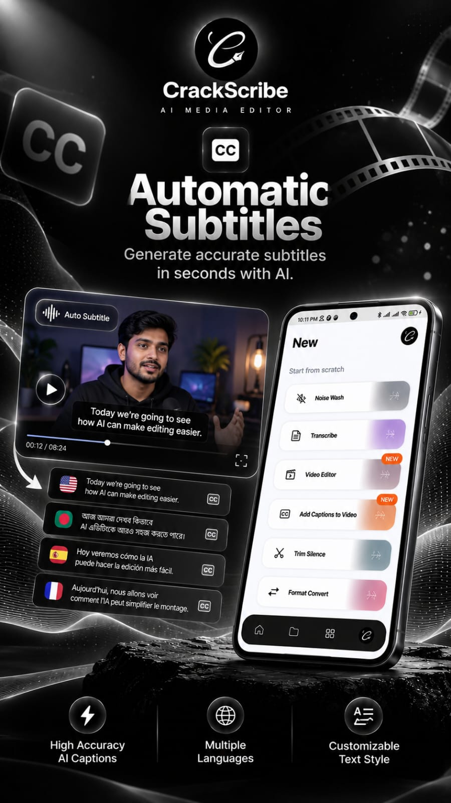
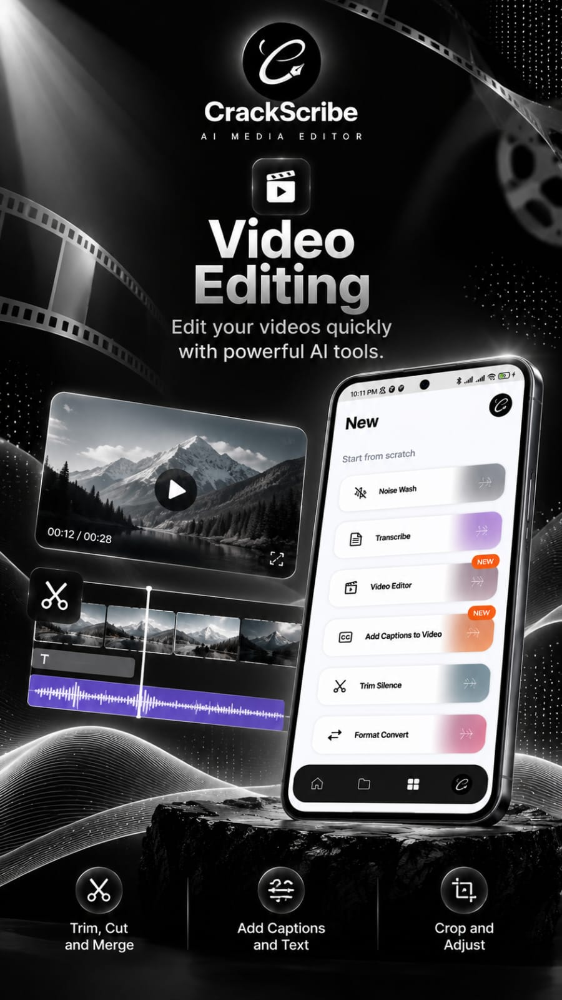
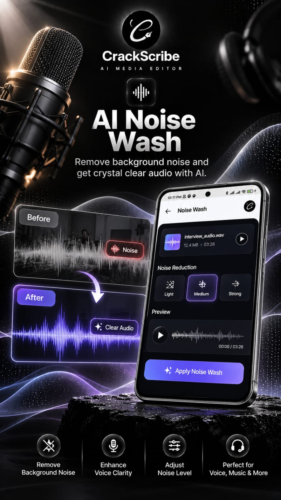
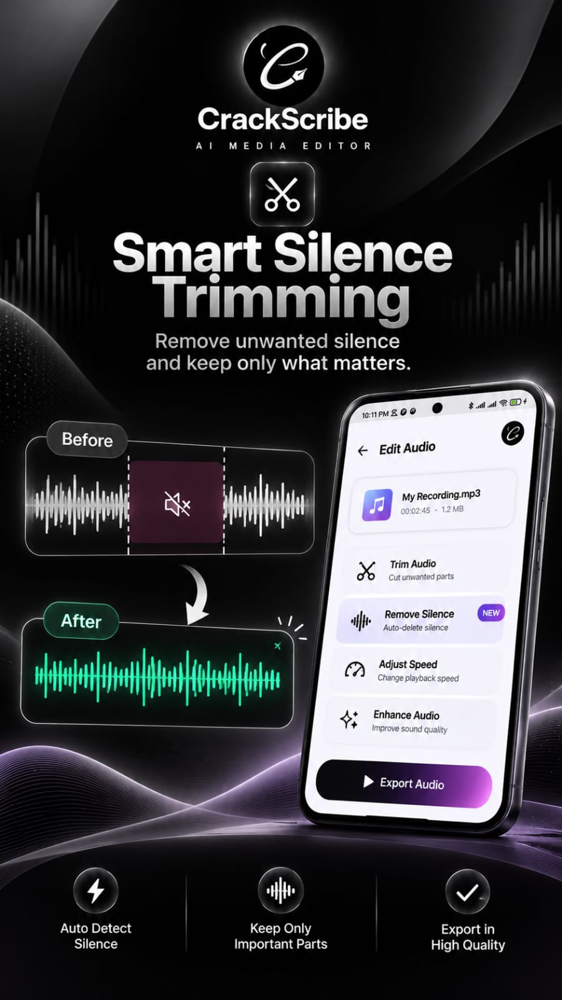
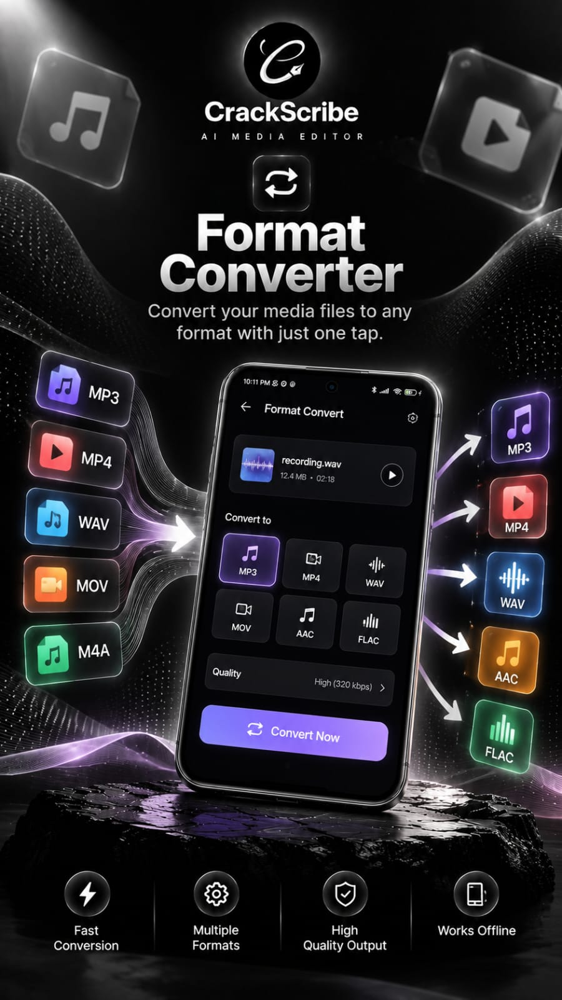

<div align="center">

# 🎧 CrackScribe: AI Audio & Video Editor

### Offline AI-Powered Audio, Video & Subtitle Studio

Transcribe speech, generate animated subtitles with 12+ creator presets, remove background noise, trim silence, edit multi-clip videos with 14+ effects & color filters, and convert media. Everything runs **on-device with native Rust AI and FFmpeg, completely offline.**

[](https://play.google.com/store/apps/details?id=com.crack404.crackscribe&pcampaignid=web_share)


**Published by [Crack404](#-about-the-company)** · Status: 🚀 **Live on [Google Play Store](https://play.google.com/store/apps/details?id=com.crack404.crackscribe&pcampaignid=web_share)**

</div>

---

## 📖 Overview

**CrackScribe** is an all-in-one mobile media studio that brings desktop-grade AI audio and video processing directly to Android smartphones. Powered by optimized **Whisper** models and a native **Rust** FFI bridge, it performs speech transcription, complex-script subtitle generation, and neural noise reduction **100% offline**, keeping user media completely private. Its built-in multi-track video editor uses **FFmpeg** with broadcast-standard **BT.709** color space encoding to merge clips, apply dynamic camera motion effects, burn in keyframe-animated ASS subtitles, and mix multi-layer audio.

> 🔒 The source repository is private because the app is signed and live in production on Google Play under **Crack404**. This repository serves as a public showcase of the product, its on-device Edge AI architecture, and its engineering features.

---

## 📱 App Screens

| | | |
|:---:|:---:|:---:|
|  |  |  |
| **Speech to Text** | **AI Subtitles Studio** | **Advanced Video Editor** |
|  |  |  |
| **AI Noise Wash** | **Silence Trimmer** | **Audio / Video Converter** |

---

## ✨ Features

### 🎙️ High-Speed Whisper Transcription & AI Subtitle Studio
- **On-Device Whisper Engine**: Accelerated Rust decoding with proportional `audio_ctx` scaling, greedy/clamped beam search optimization, and voice-bandpass pre-filtering (`80 Hz – 7600 Hz`) for fast offline inference.
- **Multilingual & Complex Script Shaping**: Full support for 99+ languages plus dedicated Indic/Bengali/Hindi ligature shaping (`Noto Sans Bengali`, `Hind Siliguri`) and grapheme-safe line wrapping.
- **12+ Creator Caption Presets & Custom Styles**: Built-in viral presets (*Bold Creator*, *Hormozi Yellow*, *Neon Glow*, *Podcast Lower*, *Karaoke Word-by-Word*, etc.) plus user-saved custom presets and custom `.TTF`/`.OTF` font importing.
- **Animation & Keyframe Timeline**: In/Out/Loop text animations, word-by-word karaoke highlighting, and a multi-point keyframe curve editor (Position X/Y, Scale, Rotation, Opacity, Blur) with 1:1 WYSIWYG preview-to-export parity.
- **Interactive Safe-Area Preview**: Drag-and-drop caption positioning with magnetic center snapping, live editable transcript lines, `.SRT` export, and one-tap burned `.MP4` rendering.

### 🎥 Advanced Multi-Track Video Editor
- **Non-Linear Timeline**: Multi-clip video/photo track, voiceover track, multi-layer background music track, and multi-logo/text overlay tracks with pinch/button zoom and playhead scrubbing.
- **Auto-Adaptive Aspect Ratios**: Automatically detects source video orientation (`16:9`, `9:16`, `1:1`, `4:3`) with instant manual ratio switching and per-clip edge crop masks.
- **14 Categorized Visual Effects**:
  - *Essentials*: Fade In, Fade Out, Monochrome B&W.
  - *Dynamic Zoom & Camera Motion*: Beat Zoom, Crash Zoom, Handheld Vlog Shake, Whip Pan Blur.
  - *Lens & Focus*: Halo Dreamy Vignette, Flash Strobe, Vertical Rebound Blur, 3D RGB Split Glitch.
  - *Retro & Texture Overlays*: Analog Film Grain, Y2K CRT Scanlines, Warm Light Leak.
- **14 Categorized Color Grading Filters**:
  - *Essentials*: Original, Vibrant, Cinematic.
  - *Retro & Nostalgic*: 90s VHS, Vintage Kodak, Disposable Cam.
  - *Moody & Aesthetic*: Dark Moody, Teal & Orange, Cyberpunk Neon.
  - *Bright & Lifestyle*: Clean Girl, Golden Hour, Pastel Dream.
  - *Stylized*: B&W Noir, Warm Sepia.
- **Broadcast-Safe BT.709 Export**: Explicit Rec.709 VUI metadata tagging (`bt709` color primaries, transfer characteristics, matrix, High Profile Level 4.1) ensuring 100% accurate colors across Facebook Desktop/Web, Instagram Reels, TikTok, and YouTube.
- **Precision Clip Controls**: High-touch `0.5x – 10.0x` playback speed controller, frame-accurate split, duplicate, reorder, and per-clip or global audio mute.

### 🪄 AI Noise Wash & Audio Processing
- **AI Noise Wash**: Neural background noise removal (Light, Normal, Strong) with side-by-side Original vs. Cleaned A/B comparison player.
- **Silence Trimmer**: Automatically detects and removes dead air from interviews, lectures, and podcasts with customizable dB threshold and minimum silence duration sliders.
- **Multi-Track Audio Mixing**: Combines original video audio, AI-denoised voiceovers, and multiple trimmed background music layers with automatic limiter protection.

### 🎵 Music Library & Format Converter
- **Jamendo Music Library & Local Audio**: Search, preview, and import royalty-free background music by mood or import local audio tracks directly from the device.
- **Format Converter**: Convert media across MP3, WAV, AAC, and M4A with adjustable bitrate (`64 kbps – 320 kbps`) and real-time file size estimation.

### ⚙️ Production Engineering, Analytics & CI/CD
- **Google Play Production Ready**: Split-ABI builds, R8/ProGuard code shrinking, dynamic Gradle manifest placeholder injection for AdMob IDs, and automatic Android `MediaScanner` indexing.
- **Firebase Google Analytics**: Production screen-view tracking via `GoRouter` observers and lifecycle telemetry.
- **Automated CI/CD Pipeline**: GitHub Actions workflow running `dart format`, `flutter analyze`, 21+ comprehensive widget & smoke tests, Rust cross-compilation (`aarch64`, `armv7`, `x86_64`), and signed AAB/APK artifact generation.

---

## 🏗️ Architecture (Edge AI / Offline-First)

Instead of relying on expensive cloud GPUs, CrackScribe processes media natively on the user's hardware.

```text
┌──────────────────────────────────────────────────────────────────┐
│                         FLUTTER APP (UI)                         │
│   State: Riverpod | Local DB: Hive CE | Routing: GoRouter        │
│   Telemetry: Firebase Analytics | Monetization: Google AdMob     │
└────────┬────────────────────────────────────────────────┬────────┘
         │ (Platform Channels)                            │ (Rust FFI)
         ▼                                                ▼
┌───────────────────────────────┐        ┌─────────────────────────────────┐
│ FFmpeg Kit (Custom Filtergraph)│        │ flutter_rust_bridge (Rust)      │
│ ----------------------------- │        │ ------------------------------- │
│ • Multi-Clip Timeline Render  │        │ • 16kHz Bandpass Audio Prep     │
│ • 14+ Camera & Lens Effects   │        │ • Whisper AI Speech-to-Text     │
│ • 14+ Color Matrix Grades     │        │ • Indic / Complex Script Decode │
│ • Keyframe ASS Subtitle Burn  │        │ • DeepFilterNet Noise Wash      │
│ • BT.709 Color Space Tagging  │        │ • Silence & Waveform Analysis   │
└───────────────────────────────┘        └─────────────────────────────────┘
         │                                                │
         ▼                                                ▼
┌──────────────────────────────────────────────────────────────────┐
│                      LOCAL DEVICE HARDWARE                       │
│          (File System, Media Codecs, CPU/NEON Threads)           │
└──────────────────────────────────────────────────────────────────┘
```

---

## 🧰 Tech Stack

### Core & Native AI

| Area | Technology / Package |
|---|---|
| Framework | Flutter (Dart `^3.5.0`), Material 3 |
| Native AI & FFI | Rust, `flutter_rust_bridge` (`2.13.0`), Whisper C++/Rust bindings |
| Video / Audio Engine | `ffmpeg_kit_flutter_new` (libass, libx264, h264_mediacodec, afftdn) |
| Local Database | `hive_ce`, `hive_ce_flutter` |
| State Management | `flutter_riverpod` |
| Navigation | `go_router` |

### Media, Fonts & Hardware

| Area | Package |
|---|---|
| Audio Playback | `just_audio`, `audio_session` |
| Video Playback | `video_player` |
| Audio Recording | `record` |
| Typography | 15+ bundled Google & Indic Fonts + custom `.TTF`/`.OTF` runtime loader |
| File & Media Scanning | `file_picker`, `path_provider`, `share_plus`, `media_scanner` |
| Notifications | `flutter_local_notifications`, `timezone` |

### Analytics, Monetization & DevOps

| Area | Technology |
|---|---|
| Analytics | `firebase_core`, `firebase_analytics` |
| Monetization | `google_mobile_ads` (AdMob Rewarded Ads with dynamic Gradle placeholders) |
| Music API | Jamendo V3.0 REST API |
| Environment & Config | `flutter_dotenv`, GitHub Secrets Base64 injection |
| CI/CD & Testing | GitHub Actions, `flutter_test` (21 widget & integration smoke tests) |

---

## 🚀 Project Status

- [x] Flutter Material 3 UI across all 6 AI & media tools
- [x] Rust FFI bridge and offline Whisper models (Official + Indic language packs)
- [x] AI Subtitle Studio with 12 presets, keyframe timeline, and 1:1 ASS export parity
- [x] Multi-track Video Editor with 14 visual effects, 14 color filters, and BT.709 color compliance
- [x] Firebase Google Analytics & AdMob production integration
- [x] Automated GitHub Actions CI/CD with 21 widget smoke tests & R8/ProGuard optimization
- [x] **Live on Google Play Store** ([Download on Google Play](https://play.google.com/store/apps/details?id=com.crack404.crackscribe))
- [ ] iOS release on the Apple App Store

---

## 🏢 About the Company

**Crack404** is the publisher of CrackScribe. The source code is kept private to protect the proprietary Rust AI integration, custom FFmpeg filtergraphs, and business logic.

---

## 👨‍💻 Author

<table>
<tr>
<td>

### Mahfuz Alam Chowdhury
**Mobile Application Developer · Software Engineer**
B.Sc. in Computer Science & Engineering

Flutter · Dart · Rust · Python/Django · On-Device AI

📍 Sylhet, Bangladesh

</td>
</tr>
</table>

Mobile developer focused on shipping production-ready apps, with multiple applications published on Google Play. Experienced in on-device AI (Whisper, DeepFilterNet), media processing with FFmpeg, and full-stack SaaS development with Django and Next.js.

| | |
|---|---|
| 🎮 **Google Play** | [CrackScribe on Google Play](https://play.google.com/store/apps/details?id=com.crack404.crackscribe) |
| 🌐 **GitHub** | [github.com/mahfuzalam25](https://github.com/mahfuzalam25) |
| 💼 **LinkedIn** | [linkedin.com/in/md-mahfuz-alam-chowdhury](https://www.linkedin.com/in/md-mahfuz-alam-chowdhury) |
| 📧 **Email** | [mahfuzalam.chowdhury.se@gmail.com](mailto:mahfuzalam.chowdhury.se@gmail.com) |
| 🏢 **Portfolio** | [mahfuzalam25.pythonanywhere.com](https://mahfuzalam25.pythonanywhere.com/) |

---

<div align="center">

© 2026 Crack404. All rights reserved.
This repository is a showcase only. The source code is proprietary and not licensed for reuse.

</div>