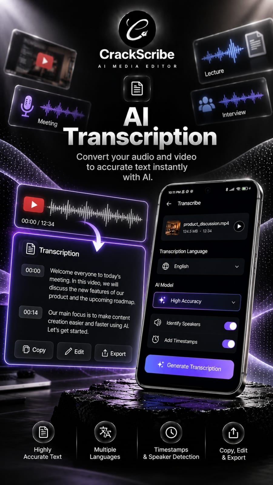
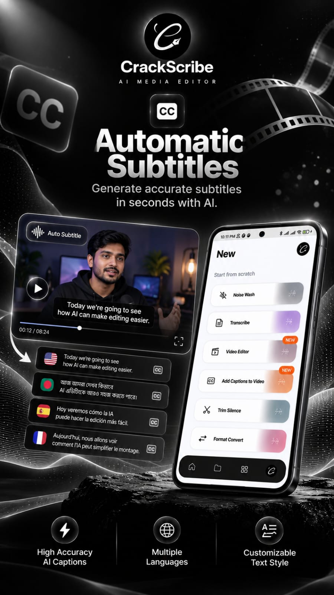
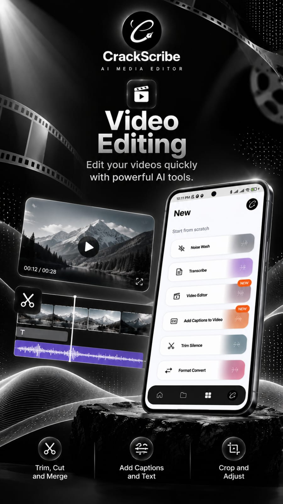
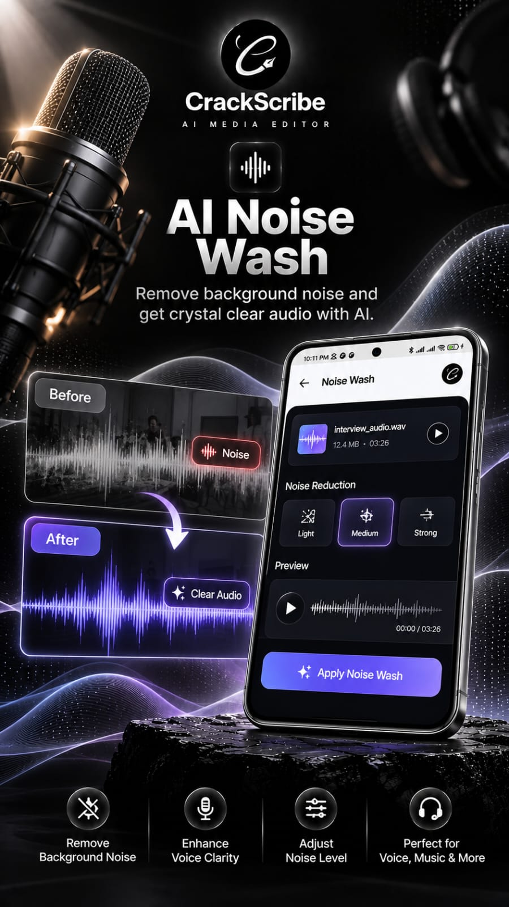
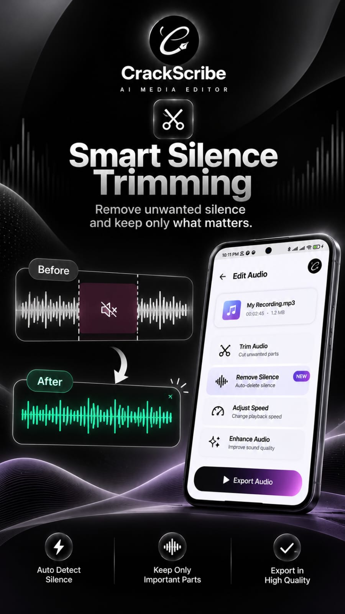
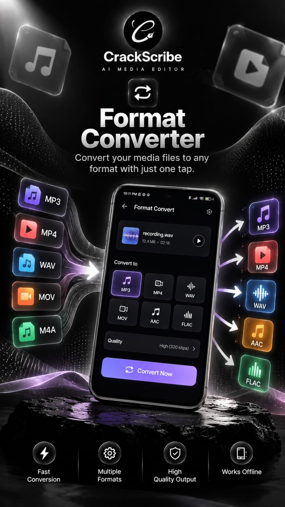

<div align="center">

# 🎧 CrackScribe: AI Audio & Video Editor

### Offline AI-Powered Audio, Video & Subtitle Studio

Transcribe speech, generate automatic subtitles, remove background noise, trim silence, edit multi-clip videos, and convert media. Everything runs **on-device with on-device AI and FFmpeg, completely offline.**


**Published by [Crack404](#-about-the-company)** · Status: 🧪 **Live in Google Play Closed Testing**

</div>

---

## 📖 Overview

**CrackScribe** is an all-in-one mobile media toolkit that brings desktop-grade AI processing directly to the user's smartphone. Using optimized **Whisper** models and a native **Rust** bridge, it performs speech transcription and noise reduction **100% offline**, which keeps user data fully private. The built-in video editor uses **FFmpeg** to merge clips, burn in styled ASS subtitles, and mix multi-track audio.

> 🔒 The source repository is private because the app is signed and currently in closed testing on Google Play under **Crack404**. This repository is a public showcase of the project, its on-device architecture, and its features.

---

## 📱 App Screens

| | | |
|:---:|:---:|:---:|
|  |  |  |
| **Speech to Text** | **AI Subtitles** | **Advanced Video Editor** |
|  |  |  |
| **AI Noise Wash** | **Silence Trimmer** | **Audio / Video Converter** |

---

## ✨ Features

### 🎙️ Whisper Transcription & Subtitles
- On-device speech-to-text using optimized **Whisper** `.bin` models
- Accurate transcripts generated completely offline, with no server uploads
- **Automatic subtitles** burned onto video frames using ASS subtitle formats via FFmpeg

### 🎥 Advanced Video Editor
- Multi-clip timeline with split, duplicate, and rearrange
- Dynamic typography: custom font sizes, bold, italic, alignment, and transparent "glass" boxes
- Visual crop masks and color grading filters (Vibrant, Cinematic)
- Custom logo and watermark overlays with exact positional control

### 🪄 AI Noise Wash & Audio Processing
- **Noise Wash** removes background hum, wind, and crowd noise
- **Silence Trimmer** automatically cuts dead air from recordings
- Multi-track mixing: original audio, recorded voice-overs, and background music

### 🎵 Music Library & Converter
- **Jamendo API** integration to search, preview, and download copyright-free music
- Format converter for MP3, WAV, M4A, MP4, and more

### ⚙️ Performance & Monetization
- **Split-ABI APK/AAB builds** targeting specific architectures (arm64, x64) for a smaller install size
- Background task execution and local notifications for long render alerts
- **Google AdMob** rewarded ads for offline processing credits

---

## 🏗️ Architecture (Edge AI / Offline-First)

Instead of relying on expensive cloud GPUs, CrackScribe processes media natively on the user's hardware.

```text
┌──────────────────────────────────────────────────────────────┐
│                       FLUTTER APP (UI)                       │
│  State: Riverpod | Local DB: Hive CE | Routing: GoRouter     │
└──────┬───────────────────────────────────────────────┬───────┘
       │ (Platform Channels)                           │ (FFI)
       ▼                                               ▼
┌─────────────────────────┐             ┌──────────────────────────────┐
│ FFmpeg Kit              │             │ flutter_rust_bridge (Rust)   │
│ ----------------------- │             │ ---------------------------- │
│ • Video Rendering       │             │ • Audio Decoding / Chunking  │
│ • ASS Subtitle Burning  │             │ • Whisper AI Inference       │
│ • Color Grade & Crop    │             │ • Background Noise Wash      │
│ • Audio Muxing          │             │ • Silence Detection          │
└─────────────────────────┘             └──────────────────────────────┘
       │                                               │
       ▼                                               ▼
┌──────────────────────────────────────────────────────────────┐
│                    LOCAL DEVICE HARDWARE                     │
│        (File System, Media Codecs, CPU/GPU Threads)          │
└──────────────────────────────────────────────────────────────┘
```

---

## 🧰 Tech Stack

### Core

| Area | Technology / Package |
|---|---|
| Framework | Flutter (Dart), Material 3 |
| Native logic | Rust, `flutter_rust_bridge` |
| Video / audio engine | `ffmpeg_kit_flutter_new` (min-gpl) |
| Local database | `hive_ce`, `hive_ce_flutter` |
| State management | `flutter_riverpod` |
| Navigation | `go_router` |

### Media & Hardware

| Area | Package |
|---|---|
| Audio playback | `just_audio`, `audio_session` |
| Video playback | `video_player` |
| Audio recording | `record` |
| File management | `file_picker`, `path_provider`, `share_plus` |
| Background tasks | `flutter_local_notifications`, `timezone` (WorkManager integration) |

### External Services & Tooling

| Area | Technology |
|---|---|
| Music API | Jamendo V3.0 API |
| Monetization | `google_mobile_ads` (AdMob rewarded) |
| Environment | `flutter_dotenv` |
| CI/CD | GitHub Actions (automated testing, ProGuard, split-ABI builds) |

---

## 🚀 Project Status

- [x] Flutter UI and all features implemented
- [x] FFmpeg integration and ASS subtitle mapping
- [x] Rust bridge and Whisper models fully integrated
- [x] ProGuard rules and release-mode optimization
- [x] Split-ABI APK / AAB builds (significantly reduced app size)
- [x] Signed with production keystore
- [x] **Published to Google Play Closed Testing**
- [ ] Production release on Google Play
- [ ] iOS release on the App Store

---

## 🏢 About the Company

**Crack404** is the publisher of CrackScribe. The source code is kept private to protect the proprietary Rust AI integration and business logic until the official release.

---

## 👨‍💻 Author

<table>
<tr>
<td>

### Mahfuz Alam Chowdhury
**Mobile Application Developer · Software Engineer**
B.Sc. in Computer Science & Engineering

Flutter · Dart · Rust · Python/Django · On-Device AI

📍 Sylhet, Bangladesh

</td>
</tr>
</table>

Mobile developer focused on shipping production-ready apps, with several applications published on Google Play. Experienced in on-device AI (Whisper, DeepFilterNet), media processing with FFmpeg, and full-stack SaaS development with Django and Next.js.

| | |
|---|---|
| 🌐 **GitHub** | [github.com/mahfuzalam25](https://github.com/mahfuzalam25) |
| 💼 **LinkedIn** | [linkedin.com/in/md-mahfuz-alam-chowdhury](https://www.linkedin.com/in/md-mahfuz-alam-chowdhury) |
| 📧 **Email** | [mahfuzalam.chowdhury.se@gmail.com](mailto:mahfuzalam.chowdhury.se@gmail.com) |
| 🏢 **Portfolio** | [mahfuzalam25.pythonanywhere.com](https://mahfuzalam25.pythonanywhere.com/) |

---

<div align="center">

© 2026 Crack404. All rights reserved.
This repository is a showcase only. The source code is proprietary and not licensed for reuse.

</div>